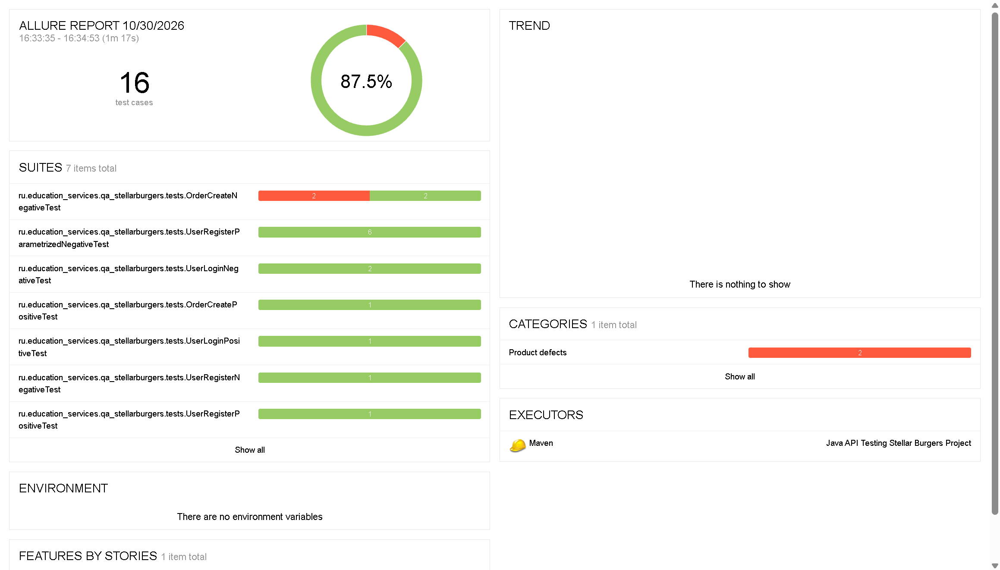
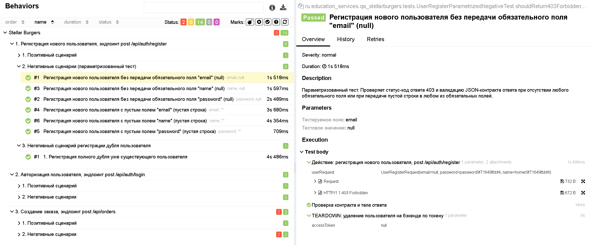
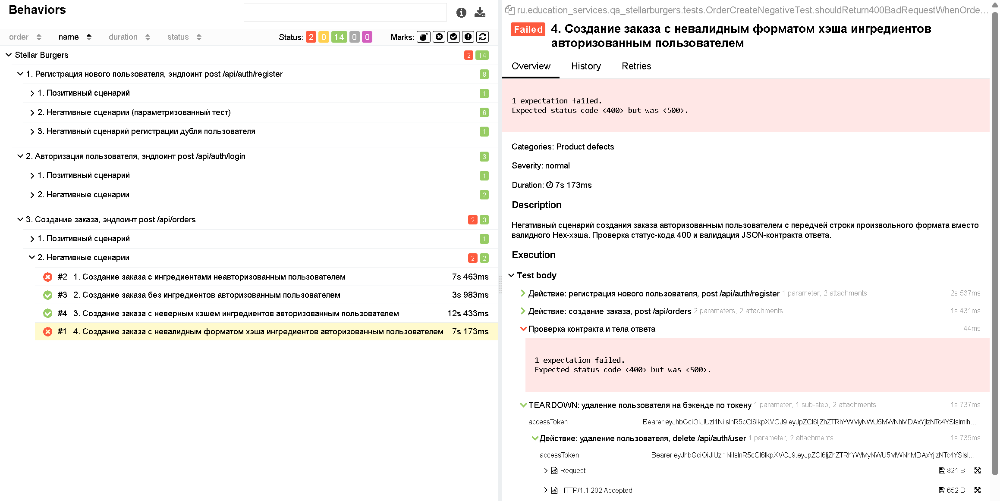

# Java API Testing Stellar Burgers Project

**Контекст и цели проекта**: проектирование отказоустойчивой и высокопроизводительной архитектуры фреймворка автоматизации API-тестов (REST Client Architecture) для полного покрытия бизнес-логики бэкенда космической бургерной и контрактной валидации данных.

**ТЗ (вид работ)**: автоматизация бэкенда (Advanced REST API Automation), разработка сервисного слоя очистки данных (Teardown Steps Pattern), предотвращение коллизий уникальных сущностей, динамическая кастомизация BDD-репортов.

**Продукт**: REST-бэкенд сервиса Stellar Burgers.

**Выполненные задачи**:
1. **REST Client Architecture**: спроектирован абстрактный слой `BaseClient` со статической неизменяемой спецификацией `BASE_SPEC` (`RequestSpecBuilder`), реализующий централизованное управление логированием (`LogDetail.URI`, `LogDetail.BODY`) и автоматическую фильтрацию Allure. Дочерние клиенты `UserClient` и `OrderClient` изолированы.
2. **Интеллектуальный Teardown-сервис**: разработан независимый отказоустойчивый класс `ApiUserTeardownSteps` для безопасного удаления сущностей в блоках `@After`. Метод снабжен валидацией токенов (`accessToken.isBlank()`), каскадным перехватом исключений (`JsonPathException`, `Exception`) и механизмами безопасной трассировки ошибок. Это гарантирует 100% очистку базы данных стенда без риска падения тестов по цепочке.
3. **Исключение коллизий данных (Math-Based Generator)**: спроектирован сложный генератор `IngredientDataGenerator`, использующий цикл `do-while` и уникальные хэши на базе `UUID` для вычисления 24-значных строк. Алгоритм гарантирует генерацию заведомо несуществующего в БД ингредиента, исключая пересечения данных в негативных сценариях.
4. **Advanced Hamcrest Assertions**: контрактная валидация полностью переведена на встроенные цепочки проверок RestAssured с применением обёрток `describedAs()`. Это обеспечивает вывод детализированных причин падения в логах сборщика. Интегрированы строгие проверки типов данных на лету (`instanceOf(Integer.class)`) и наполнения динамических полей (`notNullValue()`).
5. **Динамический Allure-Менеджмент**: реализовано управление жизненным циклом тест-кейсов Allure в рантайме с помощью `Allure.getLifecycle().updateTestCase()`. Фреймворк на лету переименовывает строки параметризованной матрицы `UserRegisterParametrizedNegativeTest` в кастомные читаемые бизнес-сценарии с автоматической подстановкой мета-параметров (`Allure.parameter`).

**Область тестирования (Scope)**: сквозные цепочки создания, авторизации, дублирования и удаления пользователей; параметризованный перебор невалидных полей (Null/Empty String проверки); позитивные сценарии генерации заказов с динамическим извлечением массива актуальных ID ингредиентов; негативные сценарии генерации заказов с невалидными форматами и несуществующими хэшами.

**Окружение**: Java (JDK 11), JUnit 4, RestAssured, Lombok, GSON, Allure Reporting, AspectJ Weaver Agent, Maven.

### Визуализация тестового репортинга Allure & Root Cause Analysis

#### 1. Общий дашборд метрик выполнения (Overview Dashboard)
Финальный срез выполнения автоматизированного тест-комплекта API. Демонстрирует покрытие целевых эндпоинтов и контрактных проверок.

#### 2. Динамическая подстановка бизнес-сценариев (Advanced BDD Behaviors)
Результат кастомизации жизненного цикла тестов через `Allure.getLifecycle().updateTestCase()`. Техническая матрица JUnit на лету преобразована в понятные, документированные сценарии с автоматической подстановкой мета-параметров полей.

#### 3. Локализованный дефект бизнес-логики бэкенда (Defect: HTTP 500 Internal Server Error)
В ходе выполнения негативного сценария `shouldReturn400BadRequestWhenOrderCreatedWithInvalidIdFormat` (создание заказа с невалидным форматом хэша) был зафиксирован критический дефект бэкенда: сервер падает в `500 Internal Server Error` вместо возврата легитимного кода валидации `400 Bad Request`. Тест задокументирован как упавший.

